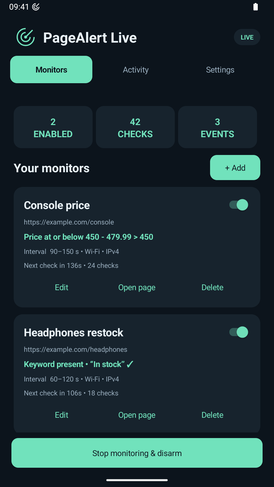

# PageAlert Live

PageAlert Live monitors multiple websites for keywords, missing text, or price drops and sounds a looping alarm until you disarm it. Each watchdog runs independently in the background with randomized check intervals and User-Agents, optional Wi-Fi/mobile and IPv4/IPv6 rotation, and notifications for HTTP errors. Watchdogs keep their creation order, and the app shows the last recorded running time if monitoring was interrupted.

[Get PageAlert Live on Google Play](https://play.google.com/store/apps/details?id=com.clinscout.pagealertlive) · [MIT License](LICENSE)

Install and update PageAlert Live through Google Play. This repository provides the source code; APK and AAB downloads are not distributed here.

  

